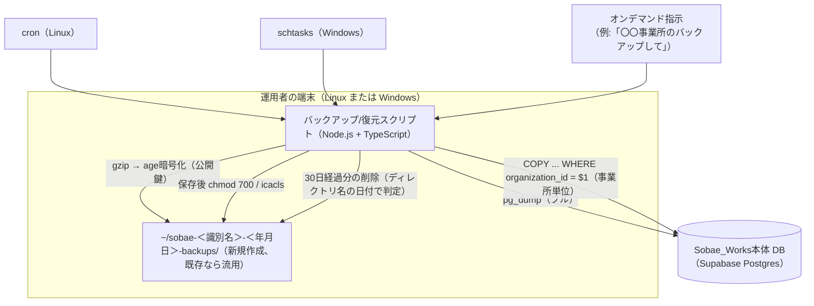
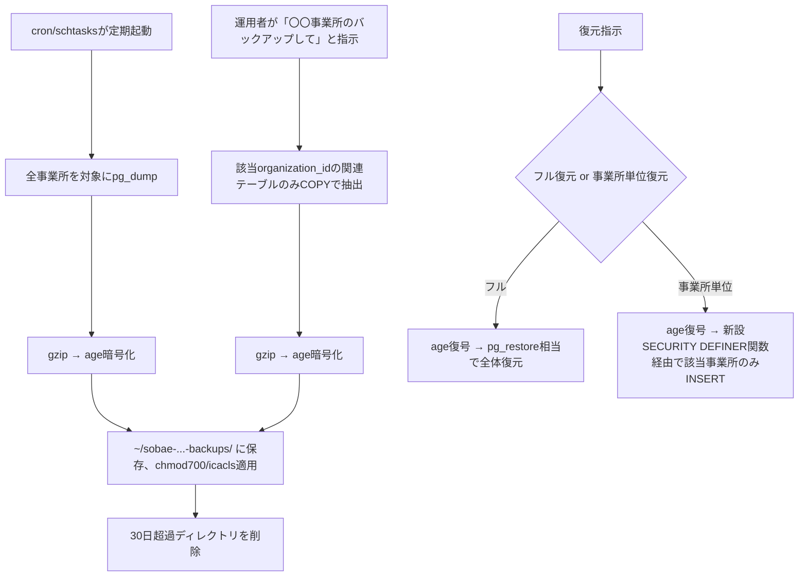
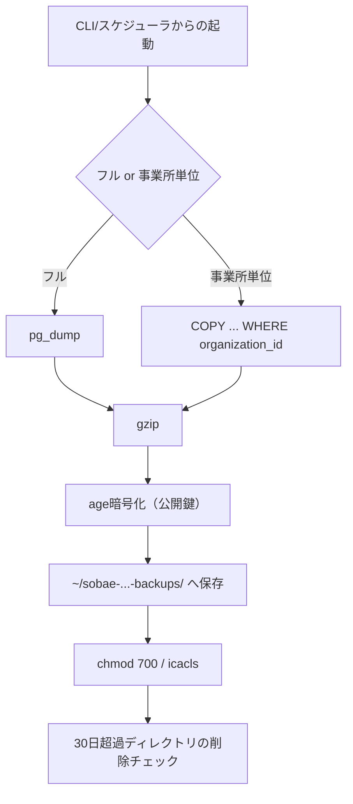

> **この文書について**
> 本文書はSOBAE-WORKS-CONSOLE側のセッションで検討したバックアップ・復元機能の設計メモです。検討の過程で「このConsoleが使うDBロール（`sobae_ops_executor`）はSECURITY DEFINER関数のEXECUTEと`v_organization_summary`のSELECTのみで、テーブルへの直接DMLができない」ことが判明し、本機能はConsole側では実現できず、**Sobae_Works本体側で実装すべき機能**と判断しました。Sobae_Works側のリポジトリ・Claude Codeセッションに引き継ぐために作成しています。
>
> 書式は同セッションで作成した `pwa_development_design_doc.md` に合わせています（添付テンプレート `systemdevelopment_document_templeate.md` の文字化けを、生き残った断片から再構成したもの。正式な見出し表記と異なる可能性があります）。プロジェクト固有情報（発行者・ステークホルダー・スケジュール・承認者など）や、Sobae_Works本体の正確なテーブル構成は、SOBAE-WORKS-CONSOLE側のコード・会話からは分からないため、**推測せず「情報不足」と明記**しています。

発行日時：2026-09-02（ドラフト作成日。正式な発行日は未確認）
発行者：情報不足のため未記入
対象チーム：情報不足のため未記入
発行番号：情報不足のため未記入

## 1. 要件定義書

### ①. プロジェクト概要

**内容**
Sobae_Works本体のDBデータをバックアップし、暗号化した状態でローカルに保存する。バックアップには2種類あり、(a) 全事業所を対象とした定期フルバックアップ、(b) 特定の事業所のみを対象としたオンデマンドバックアップ、の両方に対応する。復元も同様に、フル復元と事業所単位の個別復元の両方に対応する。

**目的**
DB全体が消失するケース（低頻度）だけでなく、特定の事業所単位でデータが消失するケース（より高頻度に起こりうる）を想定し、事業所単位で個別に復旧できるようにする。

### ②. ステークホルダー

情報不足のため記載できません。

### ③. システム構成図

SOBAE-WORKS-CONSOLE側から見て確認できている前提のみ図示（Sobae_Works本体の実際のインフラ構成・DB接続情報は情報不足）。

### ④. ユースケース（利用の流れ）

### ⑤. 工程

情報不足のため記載できません。

### ⑥. ステークホルダー定義

情報不足のため記載できません。参考として、以下は本機能をConsole側では実装できないと判断した根拠です。

- SOBAE-WORKS-CONSOLE側の`backend/src/db/client.ts`のコメントに明記の通り、Console用DBロール`sobae_ops_executor`は「`fn_*`SECURITY DEFINER関数のEXECUTEと`v_organization_summary`のSELECTのみ、テーブルへの直接DMLは一切なし」という制約付き。
- 事業所単位のバックアップには複数テーブル（`organizations`/`offices`/`staff`/`system_users`/`contract_lifecycle_log`等）への直接SELECTが、復元には直接INSERTが必要で、いずれも現行のConsole用ロールの権限を超える。
- Sobae_Works本体側の権限モデル・既存ロール構成は情報不足（SOBAE-WORKS-CONSOLEのセッションからは`sobae_lifecycle_management_design_doc.md`の実体を参照できていない）。

### ⑦. 機能要件

優先度基準：情報不足（暫定的に「高＝復旧に直結する必須機能／中＝運用性向上」で記載）

| ID | 機能名 | 概要 | 優先度 | 備考 |
| --- | --- | --- | --- | --- |
| F-301 | 定期フルバックアップ | 全事業所分のデータを`pg_dump`で取得し、age暗号化してローカル保存する | 高 | cron（Linux）／schtasks（Windows）で定期実行 |
| F-302 | オンデマンド事業所単位バックアップ | 指定した1事業所分のデータのみを抽出し、age暗号化してローカル保存する | 高 | `pg_dump`では行フィルタができないため、`COPY (SELECT ... WHERE organization_id = $1) TO STDOUT`方式が必要（②参照） |
| F-303 | フル復元 | フルバックアップから全データを復元する | 高 | 具体的な復元コマンド体系は情報不足 |
| F-304 | 事業所単位復元 | 事業所単位バックアップから、その事業所のデータのみを復元する | 高 | 外部キーを満たす順序（organizations→offices→staff→system_users→…）での復元が必要 |
| F-305 | 古いバックアップの自動削除 | 作成から30日経過したバックアップを自動削除する | 高 | ディレクトリ名に埋め込んだ日付で判定（mtimeは不採用、⑧参照） |

### ⑧. 非機能要件

| ID | 非機能名 | 概要 | 優先度 | 備考 |
| --- | --- | --- | --- | --- |
| NF-301 | 暗号化方式 | バックアップファイルは`age`で暗号化する（**公開鍵方式**で確定） | 高 | pgcryptoは不採用（検討経緯は⑨参照） |
| NF-302 | 保存先ディレクトリ | `~/sobae-＜識別名＞-＜年月日＞-backups/` 形式でホームディレクトリ直下に作成（既存なら流用） | 高 | 「識別名」の具体的な内容（固定のサービス名か、事業所名か等）は情報不足 |
| NF-303 | アクセス権限 | 保存後、Linuxは`chmod 700`、Windowsは`icacls`で管理者のみアクセス可能に制限する | 高 | `chmod 700`が制限するのは「ファイルの所有者」であり、厳密には「PCの管理者」と同義ではない点に注意（スクリプトの実行ユーザーが誰かに依存） |
| NF-304 | クロスプラットフォーム対応 | Linux/Windows両方の端末で同じスクリプトが動作すること | 高 | 実行者によって端末OSが異なるため必須。cronはLinux専用、Windowsは`schtasks`が対応 |
| NF-305 | 30日経過判定の方式 | ディレクトリ名に埋め込んだ年月日から経過日数を判定する（**mtime方式は不採用**） | 高 | 複数の異なる端末（Windows/Linux）間でバックアップがコピー・移動される可能性があり、ファイルシステムのmtimeは信頼できないと判断したため |
| NF-306 | 鍵管理 | age鍵（公開鍵／秘密鍵ペア）をリポジトリ・バックアップ保存先とは分離して管理する | 高 | 秘密鍵の具体的な保管方法は情報不足 |

### ⑨. バックアップ固有要件

**検討経緯（暗号化方式）**
- pgcryptoによる列単位の暗号化は不採用。理由：(a) 暗号化対象外の列・スキーマ情報が平文で残る、(b) 復号にDB稼働が前提になり「DBが死んでも復元できる」というバックアップ本来の目的と相性が悪い、(c) 該当列を暗号化状態で運用するとアプリのクエリ設計に恒久的な影響が出る。
- ファイル全体を暗号化する`gpg`/`age`のどちらかを検討し、`age`を採用（公開鍵方式）。

**技術的な未解決事項（要検討）**
- **事業所単位バックアップの対象テーブル一覧が未確定**：SOBAE-WORKS-CONSOLE側から確認できたのは `organizations` / `offices` / `staff` / `system_users` / `service_types`関連 / `contract_lifecycle_log` 程度。これで全部かどうかは`sobae_lifecycle_management_design_doc.md`（Sobae_Works本体側にある設計書。SOBAE-WORKS-CONSOLE側のセッションからは実体を確認できていない）を正として確認する必要がある。
- **事業所単位の抽出方式**：`pg_dump`は行フィルタに対応していないため、`COPY (SELECT * FROM <table> WHERE organization_id = $1) TO STDOUT` をテーブルごとに実行して束ねる方式が必要。
- **復元時のID/整合性方針が未確定**：元のUUIDをそのまま使って復元するか（他の何かが既に同じIDを使っていないか要確認）、新規IDを振り直すか。また「事業所単位でデータが消える」の具体的な状況（誤DELETE／論理的な無効化のみ／その他）によって復元仕様が変わる。
- **権限モデル**：Sobae_Works本体側で、事業所単位のエクスポート/インポート専用のSECURITY DEFINER関数・専用ロールを新設する必要がありそう（SOBAE-WORKS-CONSOLE側の`sobae_onboarding_executor`のような、機能ごとに権限を絞った専用ロールを追加するパターンが本体側にもあれば、それに倣うのが自然）。本体側の既存ロール構成は情報不足。

## 2. ソフトウェア方式設計

### ①. 概要

**目的**
Sobae_Works本体のDBに対して、フル/事業所単位のバックアップ・復元・自動削除を行うツールを実装する。

**技術スタック**
**Node.js + TypeScript**で確定。理由：
- OSコマンド（`pg_dump`/`gzip`/`age`/`chmod`/`icacls`）の呼び出しやスケジューラ連携が必要な「OSレベルのスクリプト」であり、PostgreSQL（PL/pgSQLや`pg_cron`）では実現不可能と判断（DBサーバー側からローカルPCのファイル操作はできない。特にSupabaseはホスティング型のため尚更）。
- Node.jsはクロスプラットフォームで、`child_process`経由でOSコマンドを呼び出せる。`process.platform`で分岐すれば1本のスクリプトでLinux/Windows両対応できる。
- TypeScriptで型定義を行いたいという要望あり。

**ファイル構成（想定、未確定）**
情報不足。本体側のリポジトリ構成が分からないため配置場所は未定。想定される機能単位：フルバックアップ実行、事業所単位バックアップ実行、フル復元、事業所単位復元、古いバックアップの削除。1本のCLIにサブコマンドとしてまとめるか、機能ごとにファイルを分けるかは要検討。

### ②. コンポーネント設計

| コンポーネント | 役割 |
| --- | --- |
| フルダンプ抽出 | `pg_dump`を実行し、DB全体のダンプを取得する |
| 事業所単位抽出 | 対象テーブルごとに`COPY (SELECT ... WHERE organization_id = $1) TO STDOUT`を実行し、束ねる |
| 暗号化 | `gzip`で圧縮後、`age -r <公開鍵>`で暗号化する |
| 保存先管理 | `~/sobae-＜識別名＞-＜年月日＞-backups/`ディレクトリを作成（既存なら流用）し、暗号化済みファイルを保存する |
| 権限ロックダウン | 保存後、Linuxは`chmod 700`、Windowsは`icacls`で権限を絞る |
| スケジューラ登録 | Linuxは`cron`、Windowsは`schtasks`で定期実行を登録する（登録作業自体を自動化するか、手順書のみ用意するかは要検討） |
| 削除（プルーニング） | 保存先ディレクトリを走査し、ディレクトリ名の埋め込み日付から30日超過を判定して削除する |
| フル復元 | age復号後、DB全体に復元する |
| 事業所単位復元 | age復号後、新設予定のSECURITY DEFINER関数経由で該当事業所のデータのみをINSERTする（外部キーを満たす順序で） |

担当者表・チーム連絡リンク・コンポーネント設計書一覧：情報不足

### ③. ヒューマンインターフェース設計

オンデマンドバックアップは「〇〇事業所のバックアップして」という自然言語の指示から起動する想定で会話が進んでいたが、これをCLIの引数指定（例：`backup-org --id <organization_id>`）として実装するか、チャットエージェント経由の別のトリガー機構を想定しているかは情報不足。復元側のUI・確認フロー（誤操作防止のための確認ステップ等）も情報不足。

### ④. データベース設計

**最重要事項**：この機能はSobae_Works本体のDBに対する直接DML（SELECT/INSERT）を必要とするため、本体側のDB権限モデルに新規のSECURITY DEFINER関数・専用ロールを追加する設計が必要になる可能性が高い。SOBAE-WORKS-CONSOLE側で確認できた事業所関連テーブルは以下（正式な全体像は本体側の設計書を参照）：

- `organizations`
- `offices`
- `staff`
- `system_users`
- `service_types` / サービス登録関連
- `contract_lifecycle_log`（`organization_id`で`organizations`参照）

これらのテーブルはSOBAE-WORKS-CONSOLE側の`sql/migrations/`ではFORCE ROW LEVEL SECURITYが有効という記述があり、本体側でも同様の制約がある可能性が高い（未確認）。

### ⑤. 危険分散の方法

情報不足。バックアップファイル自体の重複保存（複数世代保持、複数保存先など）は今回のスコープでは未検討。

## 3. ソフトウェア詳細設計

### ①. エラー処理設計

- age鍵（公開鍵）が設定されていない場合：スクリプトを異常終了させ、暗号化されないままバックアップが保存される事故を防ぐ（fail-closed）。
- 指定した事業所IDが存在しない場合：オンデマンドバックアップはエラーを返し、空のバックアップを作らない。
- 復元時に外部キー制約違反が発生した場合：トランザクションをロールバックし、部分的な復元状態を残さない。

### ②. ログ設計

情報不足。

**1. ソフトウェア全体構造**

**2. モジュール詳細**

情報不足。

---

document_id: 未定（発行番号の規約が不明なため空欄）
version: 0.1（ドラフト、SOBAE-WORKS-CONSOLE側セッションからの引き継ぎ版）
created: 2026-09-02
author: 情報不足のため未記入
approver: 情報不足のため未記入

変更履歴
20260902：SOBAE-WORKS-CONSOLE側セッションでの検討内容（pgcrypto不採用、age採用、公開鍵方式、cron/schtasks、Node.js+TypeScript、ディレクトリ名埋め込み日付方式、chmod700/icacls、フル/事業所単位のバックアップ・復元要件）をもとに初版作成

---
