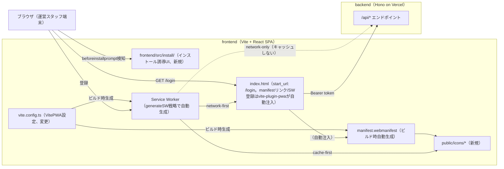
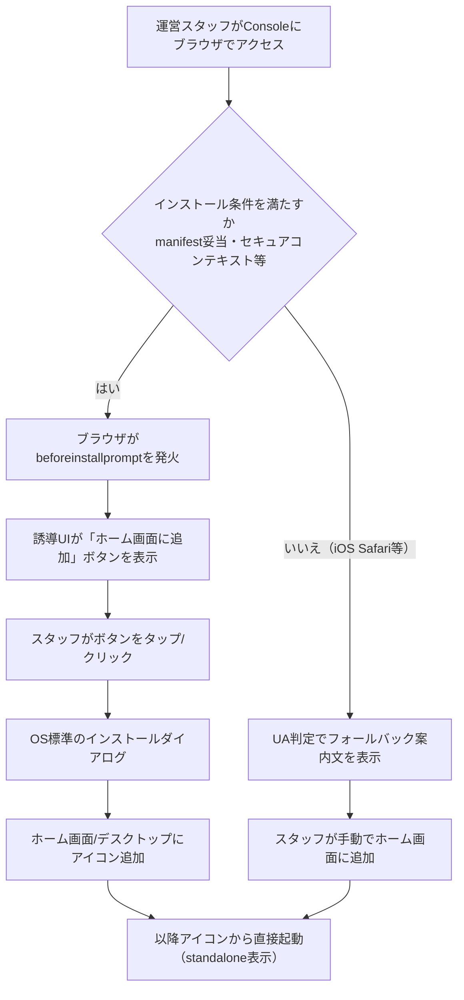
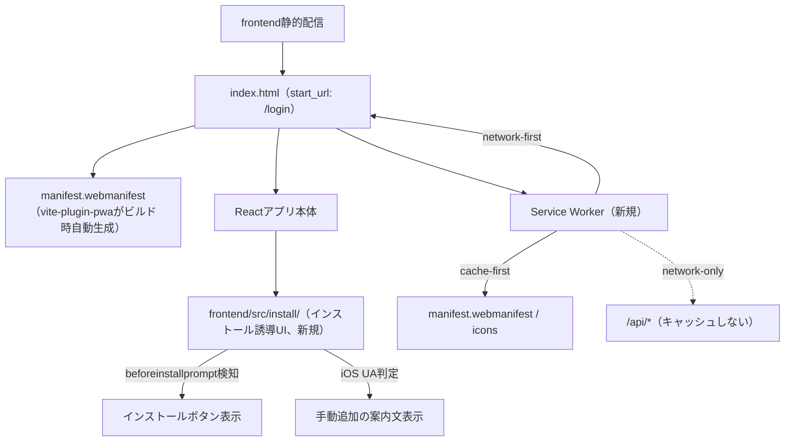

> **テンプレートについて（お断り）**
> 添付いただいた `systemdevelopment_document_templeate.md` は文字コードが破損しており（UTF-8バイト列の一部が欠落する形の文字化けで、機械的な完全復元は不可能でした）、正確な項目名をそのまま引き写すことができませんでした。本文書は、生き残った断片（見出し番号①〜⑨、テーブル構造、RACIチャート、mermaid図、`F-001`/`NF-001`/`SEC-001`等のID命名規則）から一般的な「要件定義書＋ソフトウェア方式設計書」テンプレートとして構造を再構成し、SOBAE-WORKS-CONSOLEのPWA化案件向けに作成したものです。元テンプレートの正式な見出し表記と異なる可能性があるため、必要に応じて見出し名を修正してください。
>
> また、プロジェクト固有情報（発行者・ステークホルダー・スケジュール・予算・承認者など）はこのリポジトリのコードや会話からは分からないため、**推測せず「情報不足」と明記**しています。該当箇所は追記をお願いします。

発行日時：2026-09-02
発行者：shimo（Sobae_Works_Console開発者）
対象チーム：単独開発（shimo）
発行番号：未記入（発行番号規約なしのため対象外）
承認者：shimo

## 1. 要件定義書

### ①. プロジェクト概要

**内容**
Sobae Ops Console（frontend: Vite + React SPA、backend: Hono on Vercel）を、ホーム画面に追加してアプリのように起動できるPWA（Progressive Web App）化する。具体的には、Webアプリマニフェスト（`manifest.webmanifest`）と、ホーム画面追加を促す誘導UIを実装する。

**目的**
姉妹アプリであるSobae_Works本体（別リポジトリ）が同種の機能（`src/app/manifest.ts` によるマニフェスト自動生成＋`beforeinstallprompt`を使った誘導UI、Service Workerなし＝オフライン非対応）をすでに持っている。本コンソールでも運営スタッフに同等の利用体験（ホーム画面からのフルスクリーン起動）を提供する。

### ②. ステークホルダー

確認済み：不明（本人確認により、開発者以外の明示的なステークホルダーは特定されていない）。

1. 利用者：（README上は「Sobae Works運営側向けの契約事業所ライフサイクル管理コンソール」＝社内スタッフ向けと読めるが未確認）
2. 使う目的：情報不足
3. 予算：開発者自身の設備・環境で完結するため無し（確認済み：本人回答）
4. 背景と課題
   - `[背景]` 情報不足
   - `[課題]` 情報不足
   - `[解決すべき事]` 情報不足

### ③. システム構成図

現時点でリポジトリから確認できる範囲のみ図示する（本番のホスティング先・ドメインは情報不足のため未記載）。



- frontendとbackendは別オリジン（ローカルでは `:5173` / `:3000`）。PWA化の対象は静的配信されるfrontend側のみで、backend（Hono API）には変更が及ばない見込み。
- 本番のfrontend配信先URL・カスタムドメインは情報不足。

### ④. ユースケース（利用の流れ）



### ⑤. 工程

2026年8月〜9月中旬（確認済み：本人回答）。

### ⑥. ステークホルダー定義

情報不足のため記載できません（PM・エンジニア・承認者等の体制・氏名が不明）。参考として、以下は技術的に確認済みの事実です。

- 姉妹アプリSobae_Works本体（`/home/arachnet/App/SOBAE-WORKS`、別リポジトリ）に同等機能の実装例がある。
- 本コンソールのgit commit historyは単一アカウント（`MountainBird890`）のみで確認でき、複数人体制かどうかは不明。

1. ステークホルダー一覧：情報不足
2. 関係者相関図：情報不足
3. RACIチャート：情報不足

### ⑦. 機能要件

優先度基準：情報不足（社内の優先度基準ルールが不明のため、以下は一般的な「高＝リリース前必須／中＝将来対応／低＝UX向上」の仮基準で暫定記載。正式な基準が別途あればご提示ください）

| ID | 機能名 | 概要 | 優先度 | 備考 |
| --- | --- | --- | --- | --- |
| F-101 | Webアプリマニフェスト配信 | `vite-plugin-pwa`（`generateSW`戦略）の`manifest`オプションから`manifest.webmanifest`をビルド時に自動生成し、`index.html`への`<link rel="manifest">`もプラグインが自動注入する | 高 | 確定（本人回答）。手書きの静的ファイルとしては用意しない。詳細は2章①参照 |
| F-102 | アプリアイコン一式の用意 | 192px/512px等、マニフェストが参照するアイコンを用意する | 高 | 現状 `frontend/public` には `favicon.svg`/`icons.svg` のみ、PWA用アイコン未整備 |
| F-103 | ホーム画面追加の誘導UI | `beforeinstallprompt` イベントを検知し、「ホーム画面に追加」ボタンを表示する | 高 | Sobae_Works本体の `install-guide.tsx` が参考実装になる |
| F-104 | iOS向けフォールバック案内 | iOSでは `beforeinstallprompt` が発火しないため、UA判定で手動追加手順を案内文として表示する | 高 | 同上 |
| F-105 | スタンドアロン起動 | ホーム画面から起動した際にブラウザUIなし（`display: standalone`）で開く | 中 | マニフェストの `display` 設定のみで実現、追加実装は基本不要 |
| F-106 | 起動後の遷移先制御 | マニフェストの `start_url` を `/login`（`Login.tsx`）に指定する | 高 | 確定（本人回答）。未ログイン時はログイン画面、ログイン済みなら既存の `RequireAuth`/リダイレクト処理により実質ダッシュボードへ進む想定 |
| F-107 | Service Worker導入 | オフラインキャッシュ対応のService Workerを導入する | 高 | 確定（本人回答）。キャッシュ戦略は⑨参照 |

### ⑧. 非機能要件

| ID | 非機能名 | 概要 | 優先度 | 備考 |
| --- | --- | --- | --- | --- |
| NF-101 | セキュアコンテキスト前提 | `beforeinstallprompt` およびインストール機能はHTTPSまたはlocalhostでのみ動作する | 高 | ブラウザ仕様上の制約。本番はVercelでHTTPS配信前提のため問題ないと見込むが、配信先URLは情報不足のため未確認 |
| NF-102 | オフライン対応 | Service Workerを導入し、オフラインキャッシュに対応する | 高 | 確定（本人回答）。Sobae_Works本体（Service Worker未実装）とはスコープが異なる点に注意。キャッシュ戦略は⑨参照 |
| NF-103 | 対応ブラウザ・OS範囲 | インストール機能をサポートする対象ブラウザ/OSの範囲 | 中 | 情報不足（想定端末・ブラウザの範囲が未確認） |
| NF-104 | APIレスポンスの非キャッシュ | `/api/*`（事業所一覧・ダッシュボード集計等）はService Workerでキャッシュしない | 高 | 契約事業所の生きたデータを扱うコンソールのため、古いAPIレスポンスの表示は業務上のリスクになる。network-onlyとする |

※セキュリティ要件：今回のスコープ（マニフェスト＋誘導UIのみ、Service Workerなし）では新規の攻撃面はほぼ増えない見込みです。既存のHTTPS配信・既存の認証（Supabase Auth）以外に追加で必要なセキュリティ要件があるかは情報不足のため未記載です。

### ⑨. PWA固有要件

**オフラインキャッシュ戦略（確定：本人回答＋設計提案）**

`start_url`という設定値自体はキャッシュの対象ではない（マニフェストから読み取られる静的な値であり、劣化・陳腐化しない）。キャッシュ戦略を検討すべきは「`/login`にアクセスした際に実際に返るHTML/JSの中身」の方。リソースの性質ごとに以下の方針とする。

| 対象 | 戦略 | 理由 |
| --- | --- | --- |
| `manifest.webmanifest` / アイコン | cache-first（長期TTL、目安1日程度） | ほぼ変化しない静的アセット。本人の想定通り |
| `index.html`（アプリの入口） | network-first（オフライン時のみキャッシュへフォールバック） | Viteのビルド成果物はファイル名にコンテンツハッシュが付くため、どのハッシュ付きJSを読み込むかを決める`index.html`自体が古いと、新しいデプロイをしても古いJSを参照し続けてしまう。ここが実質的に「`start_url`を最新に保つ」ために効いてくる部分 |
| ハッシュ付きJS/CSS（Viteビルド成果物） | cache-first | コンテンツハッシュにより新デプロイ＝新URLになるため、古いキャッシュを誤って掴む心配がない |
| `/api/*`（事業所一覧・ダッシュボード集計等） | キャッシュしない（network-only） | 契約事業所の生きたデータを扱うため、古いAPIレスポンスの表示は業務上のリスクになる。NF-104参照 |

**実装方式（確定：`vite-plugin-pwa` / `generateSW`戦略）**

`generateSW`戦略では、ビルド成果物（ハッシュ付きJS/CSS等）はWorkboxのprecacheの仕組みにより自動的にcache-first相当で配信される。上記の表は`vite.config.ts`の`VitePWA({ workbox: { ... } })`設定にそのまま宣言的に落とし込める想定：

```ts
VitePWA({
  registerType: 'autoUpdate', // 要検討：'prompt'にしてユーザーに更新を明示する案もある
  manifest: {
    name: 'Sobae Ops Console',
    start_url: '/login',
    display: 'standalone',
    icons: [/* F-102のアイコン一式を参照 */],
  },
  workbox: {
    // index.htmlはデフォルトのprecache対象から外し、
    // ナビゲーションリクエストとして別途network-firstを当てる
    globPatterns: ['**/*.{js,css,ico,png,svg,woff2}'],
    runtimeCaching: [
      {
        urlPattern: ({ request }) => request.mode === 'navigate',
        handler: 'NetworkFirst',
      },
      {
        urlPattern: /\/api\//,
        handler: 'NetworkOnly',
      },
    ],
  },
})
```

**実装上の注意点（要注意、実装時に外さないこと）**：`generateSW`のデフォルト挙動では、`index.html`もビルド成果物としてそのままprecacheされ、事実上cache-firstで配信されてしまう。これは⑨で定義した「`index.html`はnetwork-first」の方針と矛盾するため、上記のように`globPatterns`から`html`を除外し、`request.mode === 'navigate'`にマッチする`NetworkFirst`のruntimeCachingルールを別途定義する必要がある。これを忘れると、新しいデプロイをしても古いアプリが表示され続けるバグになる。

- プッシュ通知：要否不明（情報不足）。導入する場合はWeb Push用のVAPIDキー管理・許可UIなど追加検討が必要
- アップデート反映方針：上記の`index.html`のnetwork-first方針により、新デプロイは次回アクセス時に反映される想定。`registerType`（`autoUpdate`か`prompt`か）は実装時に要検討

## 2. ソフトウェア方式設計

### ①. 概要

**目的**
frontend（Vite + React SPA）にPWA対応（マニフェスト＋インストール誘導UI）を追加する。

**技術スタック**
`vite-plugin-pwa`を採用（確定：本人回答）。戦略は`generateSW`（Workboxベースのマニフェスト生成・Service Worker生成・ランタイムキャッシュをすべて宣言的な設定で行う方式）。手書きでService Workerを書く`injectManifest`戦略は不採用 ── 現時点でプッシュ通知やカスタムオフラインページ等、宣言的設定だけでは表現できない要件がないため、実装量の少ない`generateSW`を選んだ（検討経緯は8章に相当する内容として本文書に記載）。Web App Manifestも`vite-plugin-pwa`の`manifest`オプションから自動生成する（`manifest: false`にはしない）。

**ファイル構成（新規／変更予定）**

| ファイル | 状態 | 内容 |
| --- | --- | --- |
| `frontend/vite.config.ts` | 変更 | `VitePWA({ manifest: {...}, workbox: {...} })`を追加。マニフェスト定義とキャッシュ戦略（⑨参照）はここに集約される |
| `frontend/public/icons/` | 新規 | マニフェストが参照するアイコン一式（192px/512px等）。`manifest.webmanifest`自体は自動生成されるため手書きしない |
| `frontend/index.html` | 変更なし | `<link rel="manifest">`とService Worker登録スクリプトは`vite-plugin-pwa`が自動注入するため、手動編集は不要 |
| `frontend/src/install/` | 新規 | インストール誘導UIコンポーネント一式。配置場所確定（本人回答）：`frontend/src`直下、`pages`と同階層 |

**展開設計方針**
社内の命名規則・ディレクトリ構造ルールについては引き続き情報不足。ただし、インストール誘導UIコンポーネントの配置場所は確定済み（`frontend/src/install/`）。参考として、このリポジトリの `sql/migrations/` は `01_roles.sql` のような連番＋内容名の命名慣習を使っている。

### ②. コンポーネント設計

1. コンポーネント一覧：`vite-plugin-pwa`設定（`vite.config.ts`、マニフェスト自動生成＋`generateSW`によるService Worker生成を担う）、インストール誘導UIコンポーネント（`frontend/src/install/`、新規）
2. 各コンポーネント担当者表：情報不足
3. チーム連絡リンク：情報不足
4. コンポーネント設計書一覧：本文書のみ（詳細設計書は未作成）

### ③. ヒューマンインターフェース設計

1. ヒューマンインターフェース一覧：ホーム画面追加誘導バナー/ボタン、iOS向け手動追加手順の案内文
2. 各ヒューマンインターフェース担当者表：情報不足
3. チーム連絡リンク：情報不足
4. ヒューマンインターフェース設計書一覧：未作成

### ④. データベース設計

今回のスコープ（マニフェスト配信＋インストール誘導UI）はDBスキーマ変更を伴わない見込み（該当なし）。インストールイベントのログ等をDBに記録する要件が追加される場合は別途設計が必要（情報不足、⑧NF-102・下記②ログ設計も参照）。

### ⑤. 危険分散の方法

情報不足。静的アセット配信のみのため大きなリスクは想定しにくいが、正式な評価は未実施。

## 3. ソフトウェア詳細設計

### ①. エラー処理設計

- `beforeinstallprompt` が発火しない環境（iOS Safari等）：UA判定でフォールバック案内文を表示する（F-104）。
- マニフェスト取得に失敗した場合：ブラウザ標準の挙動に委ね、アプリ側での独自エラーハンドリングは行わない想定。
- Service Workerの登録に失敗した場合：通常のWebページとして動作を継続する（インストール・オフラインキャッシュ機能のみ無効化、アプリ自体の起動は妨げない）。
- `/api/*`への通信がオフライン時に失敗した場合：Service Worker側でキャッシュフォールバックは行わず（NF-104）、通常のfetch失敗としてフロント側の既存エラー表示に委ねる。

### ②. ログ設計

情報不足。インストールイベント（誘導表示／クリック／実際のインストール完了）のログ収集要否自体が未決定のため、ログ種別・保存先・保持期間などは記載できません。

**1. ソフトウェア全体構造**



**2. モジュール詳細**

情報不足（各モジュールの担当者表・設計書一覧は未作成）。

---

document_id: 未定（発行番号規約なしのため対象外）
version: 0.5（ドラフト）
created: 2026-09-02
author: shimo（Sobae_Works_Console開発者）
approver: shimo

変更履歴
20260902：初版作成（ドラフト、テンプレート文字化けのため見出し構造は再構成版）
20260902：バックアップ暗号化・自動削除機能を追加（v0.2）
20260902：バックアップ機能はSobae_Works本体側で扱う別システムと判明したため、本文書から削除し `backup_system_design_doc.md` に分離（v0.3）。本文書はPWA実装のみを対象とする
20260902：書誌情報（発行者/対象チーム/承認者/スケジュール/予算）を確定。Service Worker導入・キャッシュ戦略（cache-first/network-first/network-only）・start_url（`/login`）・インストール誘導UIの配置先（`frontend/src/install/`）を確定（v0.4）
20260902：`vite-plugin-pwa`（`generateSW`戦略、manifest自動生成）の採用を確定。`workbox.runtimeCaching`設定例と、`index.html`をprecache対象から除外する必要がある実装上の注意点を追記（v0.5）

---
