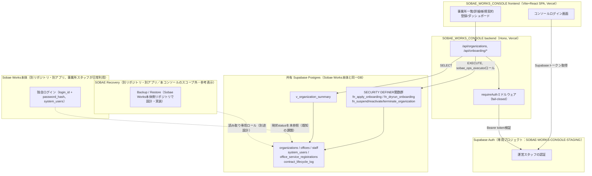
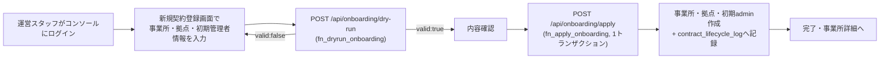
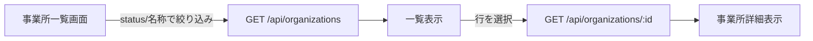
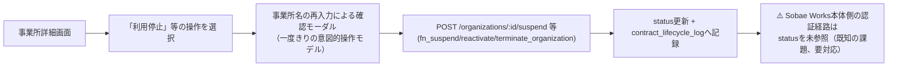
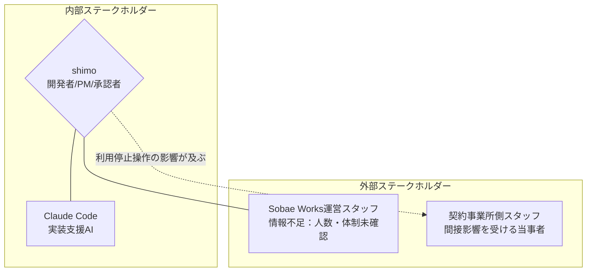
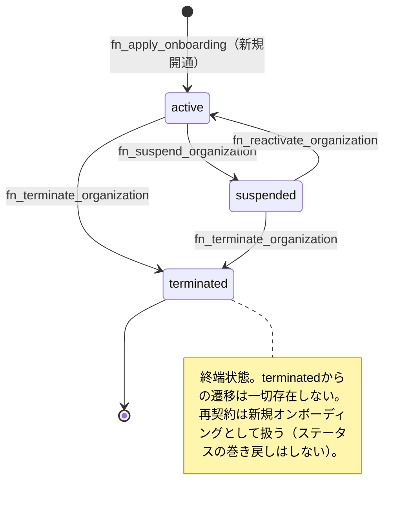

> **この文書について**
> `systemdevelopment_document_templeate.md`（添付テンプレート）の構成に沿い、`要件定義.md`（SOBAE_WORKS_CONSOLE / SOBAE Recovery の役割分離方針メモ）と、本リポジトリの現在のコード・SQLマイグレーション・既存設計書（`docs/organization_suspension_design_doc.md` / `docs/backup_system_design_doc.md` / `docs/pwa_development_design_doc.md`）を調査した結果をもとに、Claude Codeが作成した**プロジェクト全体の要件定義書**（テンプレート内「１.要件定義書」に相当する部分のみ）。方式設計・詳細設計（テンプレート２・３）は対象外。
>
> プロジェクト固有情報（スケジュール・予算・正式なステークホルダー体制など）はコード・会話履歴から確認できない範囲が多く、**推測せず「情報不足」と明記**している。該当箇所はレビューの上で追記してほしい。

発行日時：2026-09-16
発行者：Claude Code（shimoの依頼により作成、要レビュー）
対象チーム：単独開発（shimo）
発行番号：REQ-0001（本リポジトリで初めて採番するREQ文書。既存の`docs/*_design_doc.md`は発行番号未採番のドラフトのため参照なし）

## １．要件定義書

### Ⅰ. プロジェクト概要

SOBAE_WORKS_CONSOLE（社内名称：Sobae Ops Console）は、介護事業所向けSaaS「Sobae Works」の**運営側（Sobae Works社内スタッフ）**が、契約事業所（`organizations`）のライフサイクル——新規契約開通・利用停止・利用再開・契約終了——と、事業所側の初期管理者アカウントを一元管理するための社内管理コンソールである。

Sobae Works本体（契約事業所のスタッフが日常業務で使う顧客向けアプリ、別リポジトリ `/home/arachnet/App/SOBAE-WORKS`）とは**別アプリケーション・別リポジトリ**として開発するが、同一のSupabase PostgreSQL DBに接続する。本番DBを共有する以上、コンソール側の実装ミスがそのまま本体の本番データへ波及するリスクがあるため、書き込みは直接SQLを禁止し、SECURITY DEFINER関数（`fn_apply_onboarding` / `fn_dryrun_onboarding` / `fn_suspend_organization` / `fn_reactivate_organization` / `fn_terminate_organization`）経由のみに限定する設計を採る。フルスクラッチ開発。

`要件定義.md`が示す方針として、非常時のバックアップ・復旧機能（SOBAE Recovery）は権限の性質が異なるため意図的に別アプリ・別リポジトリへ分離する。この分離は既に着手されており、検討の結果「Recovery機能はConsole側のDBロール（`sobae_ops_executor`、EXECUTE+SELECTのみ）では実現不可能」と判明したため、`docs/backup_system_design_doc.md`としてSobae_Works本体側リポジトリへ引き継ぎ済み。

**本要件定義書のスコープ（2026-09-16、shimo確認）**：SOBAE Recoveryは別リポジトリの別アプリであり、本コンソール（本リポジトリ）には組み込まない。以降の本文中の「Phase 2〜4」「Recovery」に関する記載は、全体像を示すための参考情報であり、本コンソールの実装対象には含めない。

**現状（2026-09-16時点）**

| 領域 | 状態 |
| --- | --- |
| 事業所一覧・検索・ダッシュボード集計 | 実装済み |
| 事業所詳細（読み取りのみ） | 実装済み |
| 新規事業所開通（dry-run／apply） | 実装済み |
| コンソール管理者ログイン（Supabase Auth） | 実装済み |
| 利用停止・利用再開・契約終了 | DB層（SECURITY DEFINER関数・監査ログ）のみ実装済み。API／UIは未実装 |
| 操作履歴（監査ログ）閲覧 | DB層のみ実装済み。API／UIは未実装 |

さらに`docs/organization_suspension_design_doc.md`の調査により、**Sobae Works本体の認証経路が`organizations.status`を一切参照していないことが判明している**。つまりコンソール側で利用停止を実行しても、本体側の対応（別途Migration）がない限り、新規ログインも遮断されず、ログイン中セッションも生き続ける。「利用停止＝実際にアプリを使えなくする」という要求は、コンソール単体の実装だけでは満たせない（詳細は §Ⅷ SEC-005）。

### Ⅱ. ヒアリング

1. **利用者**：Sobae Works運営側スタッフ（社内）。開発者はshimo（単独開発、実装補助としてClaude Codeを利用）。
2. **使う目的**：契約事業所のオンボーディングから解約までのライフサイクルを、DBへの手作業操作に頼らず、安全なUI経由で一元管理する。
3. **背景と課題**

   `[背景]`
   これまでの事業所登録・利用停止の運用実態（手作業／DB直接操作の有無）は本調査の範囲では確認できていない（情報不足）。確実に言えるのは、少なくとも本体側の実装だけでは「事業所停止＝ログイン不可」という前提が保証されていない状態にあるということ（Ⅰ参照）。

   `[課題]`
   - 単独開発体制であり、要件定義・実装・レビューが同一人物（＋AI）に集中する。
   - 本体（Sobae Works）と同一DBを共有するため、コンソール側の設計ミスが本番データへ直接影響し得る。
   - 事業所の状態（`active`/`suspended`/`terminated`）と本体側の認証判定が同期していない既知のギャップがある（§Ⅷ SEC-005）。

   `[解決したい事]`
   1. レスポンシブ対応：**後回し（2026-09-16、shimo確認）**。当面はPC利用を前提としたインラインスタイル中心の実装のまま進め、モバイル対応は別途優先度を上げるタイミングで着手する。
   2. 予算：情報不足。
   3. その他：事故の影響範囲を最小化するため、日常管理（本コンソール）と非常時対応（バックアップ・復旧＝SOBAE Recovery）を権限ごと別アプリに分離する（`要件定義.md`）。SOBAE Recoveryは別リポジトリで扱い、**本コンソールのスコープには含めない**（2026-09-16、shimo確認）。

### Ⅲ. システム構成図

コンソール操作者（Sobae Works運営スタッフ）の認証と、契約事業所側の管理者・スタッフの認証は**別の仕組み**であることに注意（過去README上で混同されていた経緯があり、2026-09-02に修正済み）。前者はコンソール専用のSupabaseプロジェクト（`SOBAE-WORKS-CONSOLE-STAGING`）のSupabase Authを使い、後者は本体独自の`login_id`＋`password_hash`（`system_users`テーブル、bcrypt）方式でSupabase Authを使わない。

### Ⅳ. ユースケース（利用の流れ）

**1. 新規事業所開通（オンボーディング）**

`application_id`（UUID、フロント側で発番）にUNIQUE制約があり、applyが未成功の間は同一IDで再送しても安全（冪等）。途中で失敗した場合は関数全体がロールバックされ「半分だけ作られた事業所」は残らない。

**2. 事業所検索・閲覧**

**3. 利用停止／利用再開／契約終了（設計済み・API/UI未実装）**

### Ⅴ. 工期

情報不足（正式なスケジュール・納期は未確認）。参考として、コード・設計書から追える実装フェーズの進捗を記載する（`要件定義.md`のロードマップに基づく。日付ベースの工期は不明のため代替）。**本コンソール（本リポジトリ）のスコープはPhase 1のみ**（2026-09-16、shimo確認）。Phase 2〜4（SOBAE Recovery）は別リポジトリの別アプリの範囲であり、参考情報として記載するのみで本文書の実装対象ではない。

| フェーズ | 内容 | 状態（2026-09-16時点） |
| --- | --- | --- |
| Phase 1（本コンソールのスコープ） | 事業所一覧・詳細・新規事業所開通・利用停止・利用再開・監査ログ | 一部実装中（一覧/詳細/開通は実装済み、停止/再開/終了はDB層のみ実装済み・API/UI未着手） |
| Phase 2〜4（参考・本コンソールのスコープ外） | SOBAE Recovery：Backup・暗号化・Local Restore・Verify／過去データ比較／Production部分復旧 | 別リポジトリ（Sobae Works本体側）で設計・実装。`docs/backup_system_design_doc.md`として引き継ぎ済み |

### Ⅵ. ステークホルダー定義

単独開発体制のため、テンプレートの人員規模を前提とした標準的なステークホルダー構成とは異なる。実在が確認できない役職・氏名は記載しない。

**1. ステークホルダー一覧**

| 区分 | 役割 | 氏名／担当 | 主な責任・権限 | 承認権限 | 備考 |
| --- | --- | --- | --- | --- | --- |
| 内部 | 開発者 兼 PM 兼 承認者 | shimo | 要件定義・実装・受け入れ判断全般 | 最終承認 | 単独開発 |
| 内部 | 実装支援AI | Claude Code | コード実装・調査・ドキュメント作成支援 | なし | DBロール/関数/ビュー設計・インフラ設定はshimoの担当範囲（`scope_boundary_app_vs_infra`方針）、Claude Codeは実装のみ |
| 外部 | Sobae Works運営スタッフ（利用者） | 情報不足（人数・体制未確認） | コンソールの日常利用 | なし | shimo以外に利用者がいるか未確認 |
| 外部 | 契約事業所側スタッフ（間接影響） | 情報不足 | コンソール操作（特に利用停止）により認証可否へ直接影響を受ける | なし | コンソールを直接操作しない当事者 |

**2. 関係者マップ**

**3. RACIチャート**

| タスク | shimo | Claude Code |
| --- | --- | --- |
| 要件定義 | A/R | C |
| DBロール・関数・ビュー設計 | A/R | I |
| フロントエンド/バックエンド実装 | A | R |
| コードレビュー・受け入れ判断 | A/R | I |
| Vercel/Supabase等インフラ設定 | A/R | I |
| ブランチ統合（staging→main）・Production反映 | A/R | I |

*R 実行責任者　A 最終責任者　C 相談対応者　I 報告対応者*

### Ⅶ. 機能要件

優先度基準：高＝リリース初期に必須／中＝将来的な実装を想定／低＝UX向上・オプション対応

| ID | 機能名 | 概要 | 優先度 | 状態 | 備考 |
| --- | --- | --- | --- | --- | --- |
| F-001 | 事業所一覧表示 | 契約事業所の一覧をstatus/名称で絞り込み表示 | 高 | 実装済み | `GET /api/organizations` |
| F-002 | ダッシュボード集計 | active/suspended/terminated件数の集計表示 | 高 | 実装済み | `GET /api/organizations/summary` |
| F-003 | 事業所詳細表示 | 事業所1件の詳細情報表示（読み取りのみ） | 高 | 実装済み | `GET /api/organizations/:id` |
| F-004 | 新規事業所開通 | 事業所・拠点・サービス登録・初期管理者をまとめて登録 | 高 | 実装済み | dry-run/apply、1トランザクション、冪等 |
| F-005 | 初期admin発行 | 初期管理者（system_user）のログインID/パスワード発行 | 高 | 実装済み | F-004に内包。パスワードはbcryptハッシュ化のみ通過、平文はDB保存なし |
| F-006 | 事業所利用停止 | activeな事業所をsuspendedへ遷移 | 高 | DB関数実装済み／API・UI未実装 | `fn_suspend_organization` |
| F-007 | 利用再開 | suspendedな事業所をactiveへ遷移 | 高 | DB関数実装済み／API・UI未実装 | `fn_reactivate_organization` |
| F-008 | 契約終了 | active/suspendedな事業所をterminated（終端）へ遷移 | 中 | DB関数実装済み／API・UI未実装 | `fn_terminate_organization`。再契約は新規オンボーディング扱い |
| F-009 | 操作履歴（監査ログ）閲覧 | 事業所ごとのライフサイクル操作履歴を時系列表示 | 高 | DB（`contract_lifecycle_log`）実装済み／API・UI未実装 | 誰が・いつ・どの事業所を・なぜ操作したかを記録 |
| F-010 | コンソール管理者ログイン | Sobae Works運営スタッフのログイン（メール＋パスワード） | 高 | 実装済み | Supabase Auth、自己サインアップ不可（許可リスト方式） |
| F-011 | 管理者アカウント確認 | コンソール利用スタッフ（system_user側ではなくコンソール側運用者）のアカウント一覧確認 | 中 | 未実装 | `要件定義.md`記載機能。現行コードに該当APIなし |
| F-012 | 契約状況確認 | 契約開始日・終了日・状態の確認 | 高 | 実装済み | F-003に内包 |
| F-future-1 | プラン変更 | 契約プランの変更 | 低（将来） | 未着手 | `要件定義.md`将来項目 |
| F-future-2 | 利用状況確認 | 事業所の利用状況モニタリング | 低（将来） | 未着手 | `要件定義.md`将来項目 |
| F-future-3 | レスポンシブ対応 | モバイル/タブレット幅でのUI最適化 | 低（後回し） | 未着手 | 2026-09-16、shimo確認により後回し |

**スコープ外（別リポジトリ）**：SOBAE Recovery関連（Backup/Restore/過去データ比較/Production部分復旧）は本コンソールの機能要件に含めない（2026-09-16、shimo確認）。

### Ⅷ. 非機能要件

優先度基準はⅦと同じ。

| ID | 非機能名 | 概要 | 優先度 | 備考 |
| --- | --- | --- | --- | --- |
| NF-001 | DB書き込み経路の制限 | 既存業務テーブルへの直接INSERT/UPDATE/DELETEを禁止し、SECURITY DEFINER関数経由のみとする | 高 | `sobae_ops_executor`はEXECUTE＋`v_organization_summary`のSELECTのみ保有 |
| NF-002 | 権限分離（ロール） | Ops API用ロール（`sobae_ops_executor`）と関数所有者ロール（`sobae_onboarding_executor`）を分離 | 高 | 関数バグの影響範囲を最小テーブル群に限定する目的 |
| NF-003 | 監査ログ | 全ライフサイクル操作（created/suspended/reactivated/terminated）を`contract_lifecycle_log`に記録 | 高 | organization_id, application_id, event_type, status_before/after, applied_at, applied_by等 |
| NF-004 | オンボーディングの原子性・冪等性 | 事業所＋拠点＋サービス登録＋初期管理者作成を1トランザクションで実施し、`application_id`により再送を安全化 | 高 | `fn_apply_onboarding` |
| NF-005 | 状態遷移の多層防御 | `active↔suspended`、`(active\|suspended)→terminated`のみを許可し、UI・API・DB関数それぞれで独立に不正遷移を拒否 | 高 | `terminated`は終端状態。巻き戻し不可 |
| NF-006 | 認証のfail-closed設計 | Supabase環境変数未設定時は機能停止（503）とし、認証なしでの通過を許さない | 高 | `requireAuth`ミドルウェア、`DATABASE_URL`未設定時も同様に503 |
| NF-007 | ブランチ運用・デプロイ制御 | `staging`→`feature/fix`→Preview確認→`staging`→`main`の順を必須とし、`main`直接コミット/push・force push・履歴書き換えを禁止 | 高 | 本番DBを共有するため事故防止の明文ルール |
| NF-008 | PWA対応 | ホーム画面追加によるアプリ的起動を可能にする | 中 | 実装済み（`vite-plugin-pwa`、`manifest.webmanifest`） |
| NF-009 | Production DB接続の制限 | `sobae-works-production-tokyo`への接続はshimoの承認なしに行わない | 高 | 開発は常にstaging環境（`sobae-works-staging-tokyo`）で行う |

**セキュリティ要件**

| ID | セキュリティ項目 | 要件内容 | 対応層 | 優先度 | 備考 |
| --- | --- | --- | --- | --- | --- |
| SEC-001 | API認証 | `/health`以外の全`/api/*`は`Authorization: Bearer <Supabase access token>`を必須とする | API層 | 高 | 未設定時503、トークン欠落・不正時401 |
| SEC-002 | ログイン方式の限定 | コンソール管理者ログインは事前払い出しのメール＋パスワードのみ。自己サインアップUIは提供しない | フロント/Auth層 | 高 | 許可リスト方式 |
| SEC-003 | 入力バリデーション | Zodスキーマによるフロント／バックエンド二重検証、DB側CHECK制約による三重目の防御 | フロント/API/DB層 | 高 | 例：郵便番号7桁、login_idの形式（半角英小文字・数字・ハイフン）等 |
| SEC-004 | 破壊的操作の確認 | 利用停止/再開/終了の実行には、事業所名の再入力を伴う確認モーダルを必須とする（「一度きりの意図的操作」モデル） | フロント層 | 高 | 設計済み・未実装（`docs/organization_suspension_design_doc.md` SEC-005/UI-0006） |
| SEC-005 | **【既知の重大ギャップ・要レビュー】本体側の認証経路が事業所status未参照** | Sobae Works本体のログイン処理（`fn_get_user_for_auth`）・セッション継続チェック（`fn_get_system_user_auth_state`）はいずれも`system_users.is_active`のみを見ており、`organizations.status`／`is_active`をJOINしていない。コンソール側で利用停止を実行しても、本体側に対応するmigrationが入るまでは新規ログイン拒否・既存セッション失効のいずれも機能しない | 認証層（Sobae Works本体側の対応が必要） | 高 | `docs/organization_suspension_design_doc.md` §1.3, §4に詳細。F-006/F-007/F-008の前提を崩す既知の未解決事項として、Console側の実装着手前にレビューで対応方針を決定すること |

### Ⅸ．事業所ライフサイクル状態遷移固有要件

- `status`列は`organizations`テーブルの既存カラム`is_active`（boolean）の上位互換として扱う：`status='active'`の間だけ`is_active=true`、`suspended`/`terminated`では`is_active=false`に同期する（各`fn_*`関数が自動で同期）。
- すべての遷移で`contract_lifecycle_log`に`organization_id`・`management_number`・`event_type`・`status_before`／`status_after`・`applied_at`・`applied_by`（操作者、Supabaseセッションからバックエンドが解決——フロントから任意の`applied_by`を送らせない設計）を記録する。
- `organizations`／`offices`／`staff`／`system_users`はFORCE ROW LEVEL SECURITYが有効なため、各`fn_*`関数は書き込み区間のみ`app._procedure_context`セッション変数を立てて本体側RLSポリシーを通過する（本体の`proc_create_staff`等と同一パターン）。

---

document_id: REQ-0001
version: 1.0（v1、初版）
created: 2026-09-16
author: Claude Code（shimoの依頼により作成）
approver: shimo（要確認・未承認）

変更履歴
20260916：`systemdevelopment_document_templeate.md`と`要件定義.md`、および現在のリポジトリ調査（SQLマイグレーション01〜10、backend/frontendコード、既存設計書3点、プロジェクトメモリ）をもとに初版作成。テンプレートの「１.要件定義書」部分のみを対象とし、「２.ソフトウェア方式設計」「３.ソフトウェア詳細設計」は対象外。SEC-005（本体側認証経路が事業所statusを未参照）を既知の重大ギャップとして明記。
20260916（同日追記）：shimo確認により2点のスコープ判断を反映。①SOBAE Recovery（Phase 2〜4）は別リポジトリの別アプリとし、本コンソールの要件・実装対象から除外（参考情報としてのみ記載を残す）。②レスポンシブ対応（UIのモバイル最適化）は優先度を下げ後回しとする（F-future-3として記録）。
